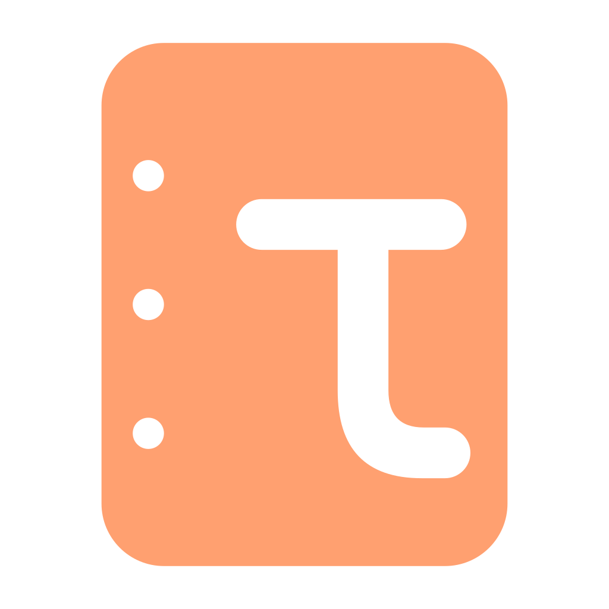
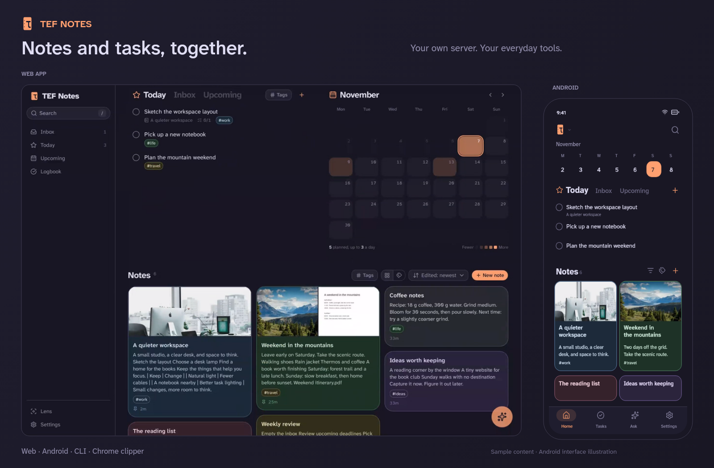
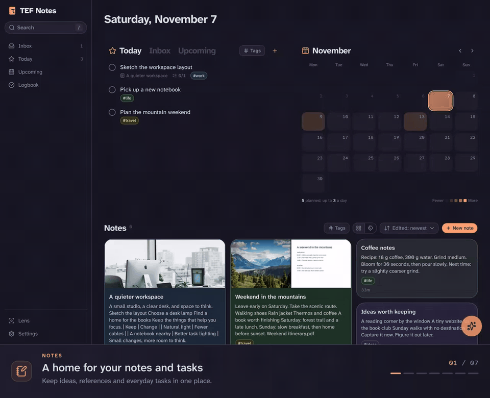

<p align="center">
  
</p>

<h1 align="center">TEF Notes</h1>

<p align="center">
  <strong>Your notes and tasks. On your own server.</strong><br>
  Write in Markdown, link tasks to your notes, and work with an optional assistant that asks before it writes.
</p>

<p align="center">
  <a href="#get-started">Get started</a> ·
  <a href="#demo">Watch the demo</a> ·
  <a href="#documentation">Documentation</a> ·
  <a href="CONTRIBUTING.md">Contribute</a>
</p>

<p align="center">
  <a href="LICENSE"></a>
  <a href="web/README.md"></a>
  <a href="mobile/README.md"></a>
</p>



*The web app and an illustrated Android screen, using sample content. Rosé Pine theme, orange accent.*

## Notes and tasks, together

### Capture what you want to keep

Write Markdown notes with checkboxes, tables and code. Add photos, PDFs and Excalidraw drawings. Save pages and
pictures with the Chrome clipper, and open articles in a distraction-free Reader view.

### Keep tasks close to their context

Work through Inbox, Today, This Evening, Upcoming and Logbook. Add checklists, deadlines, reminders and repeating
tasks. Link a task to the notes it belongs with, and find those tasks again from the note.

### Ask an assistant that knows what is open

Search and discuss your notes, or ask the assistant to add a task or edit a note. It sees the page you are on and
shows changes for approval before saving by default. Choose your model provider, including a local model through
Ollama. Auto-tagging and web search are optional too.

### Keep control of your data

Run the server yourself. The Android app keeps an offline copy and merges edits when it reconnects. Export notes
and their attachments as files with the CLI. Notes and tasks remain usable without configuring an AI provider.

### Focus with lenses

A lens filters **notes and tasks together**. Give each one a name and choose the tags it includes or hides:

| Lens | What you see |
|---|---|
| Work | Notes and tasks tagged `work` |
| Life | Notes and tasks tagged `home` or `travel` |

Switch the lens to change your focus. A new note or task inherits the lens’s first tag.

## Demo



*A one-minute tour with sample data. The assistant interaction uses the real agent.*

## Get started

> [!IMPORTANT]
> **TEF Notes is a personal app for a private network. There is no sign-in.** Anyone who can reach the server can
> read, edit and delete its data. Keep its ports on loopback, use a private-network reverse proxy for your devices,
> and never expose it to the public internet. Read the [security model](SECURITY.md) before deploying.

You need Docker with Compose. `docker compose up -d` pulls the published images (the server with the web app, and the
agent) for amd64 and arm64; building from source, which is also how the signed clipper is made, is in the
[server setup](server/README.md). Want an AI agent to do the install for you? Give it the [self-host skill](skills/self-host/SKILL.md).

```sh
git clone https://github.com/spyrosbazios/tef-notes.git
cd tef-notes/server
cp .env.example .env
mkdir -p keys/typesafe keys/deepseek keys/exa keys/push
# Edit .env: set TEF_NOTES_URL to your private origin and choose TZ.
docker compose up -d
```

On the server machine, open [localhost:8097](http://localhost:8097). To use the app from your phone or another
computer, configure the private reverse proxy described in the [server setup](server/README.md#security-model-read-first).
Both `/api` and `/agent` must reach the same private origin. AI keys are optional; add them when you want those features.

### Use it where you are

| Client | How to get it |
|---|---|
| **Web** | Included in the server build; open your server’s URL. [Web guide](web/README.md) |
| **Android** | Install the APK from the [latest release](https://github.com/spyrosbazios/tef-notes/releases/latest), then enter your server’s URL. [Android guide](mobile/README.md) |
| **Chrome clipper** | Build and sign it with the server, then install from its private HTTPS origin. [Clipper guide](extension/README.md) |
| **CLI** | Run `tefnotes` with Bun to read, edit and export notes and tasks. [CLI guide](cli/README.md) |
| **MCP** | Enable the server endpoint to connect another agent harness. [MCP guide](server/agent/README.md#mcp-the-tools-for-another-agent-harness) |

The UI is in English. Notes can be in any language.

## AI providers

All AI features are optional. The assistant runs on your server and uses the model provider you configure; the
clients hold no model keys. You can choose DeepSeek, Anthropic, OpenAI, Grok, Qwen, Z.ai or Ollama.

See [AI providers and configuration](docs/ai-providers.md) for models, key files, auto-tagging and web search.
Content sent to a configured provider leaves your server. Leave its key out to keep that feature off.

## Backups

Back up `server/pb_data/`: it holds the database and attachments. TEF Notes does not provide automatic backups.
Use PocketBase’s backup API, or stop the containers before copying the directory. Test a restore before relying on
it. See the [backup guide](server/README.md#backups).

## Documentation

| Start here | What it covers |
|---|---|
| [Server setup](server/README.md) | Installation, private proxy, configuration, upgrades and backups |
| [Security](SECURITY.md) | Network access, AI data handling and vulnerability reports |
| [AI providers](docs/ai-providers.md) | Optional models and keys, auto-tagging and web search |
| [Chat agent and MCP](server/agent/README.md) | Assistant context, approval cards, widgets and external harnesses |
| [Architecture](ARCHITECTURE.md) | Repository layout, note format, links, sync and the write contract |
| [Contributing](CONTRIBUTING.md) | Development setup, module checks and contribution rules |

## Contributing

Bug reports, feature ideas and code contributions are welcome. [Open an issue](https://github.com/spyrosbazios/tef-notes/issues)
with what you expected, what happened and how to reproduce it. For code changes, start with [CONTRIBUTING.md](CONTRIBUTING.md).
Report security issues through the process in [SECURITY.md](SECURITY.md).

## License

[GNU AGPL-3.0](LICENSE). Contributions require a one-time [Contributor License Agreement](CLA.md).
The Atkinson Hyperlegible fonts use the [SIL Open Font License](mobile/assets/fonts/OFL.txt).
